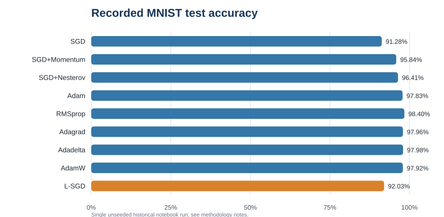
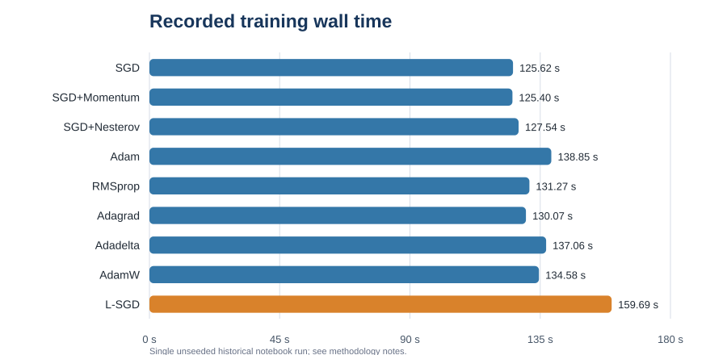

# CNN Optimizer Benchmark on MNIST

A compact academic project comparing standard optimizers with a custom lightweight SGD-style optimizer for CNN image classification. It includes a Streamlit dashboard, the original notebook for provenance, the notebook's saved results, and a seeded script for a cleaner rerun.

## Project summary

- **Task:** classify handwritten digits using the MNIST dataset.
- **Model:** two convolutional layers followed by two fully connected layers.
- **Original run:** 20% of the 60,000 MNIST training images (12,000 samples), batch size 64, five epochs, and all 10,000 official test images.
- **Optimizers:** SGD, SGD with momentum, Nesterov SGD, Adam, RMSprop, Adagrad, Adadelta, AdamW, and custom L-SGD.
- **Custom L-SGD idea:** error feedback, top-k gradient sparsification, and symmetric 8-bit gradient quantization simulation. Model parameters remain float32 in the supplied implementation; the experiment is not hardware quantization or on-device training.

## Recorded results from the supplied notebook





The strongest recorded test accuracy was **98.40% for RMSprop**. The custom L-SGD run recorded **92.03% accuracy** and took **159.69 seconds**; ordinary SGD recorded **91.28%** and took **125.62 seconds**. This was one unseeded run, so results can vary and do not establish a statistically reliable ranking.

The notebook's only memory observations were process RSS changes of 114.11 MB for SGD and 18.54 MB for L-SGD. RSS is affected by runtime and system state; these two readings are not a direct optimizer-state memory benchmark, RAM peak measurement, energy measurement, or embedded-device result. The dashboard labels them accordingly and does not claim verified memory savings.

## Important source and evidence notes

The notebook says MNIST in its code and downloads `torchvision.datasets.MNIST`; it executes five epochs, uses PyTorch, and contains no STM32 firmware or deployment process. The accompanying course-report PDF describes Fashion-MNIST, seven epochs, Keras/PyTorch comparisons, and STM32 deployment. Those report claims do not match the code supplied for this repository, so this project follows the notebook and makes no claim of verified Fashion-MNIST or STM32 results. The report PDF is not redistributed here because it includes a coauthor's university contact details and its hardware claims need supporting artifacts.

The original notebook also contains a chart that derives an *estimated accuracy trend* from training loss rather than measured per-epoch accuracy. That chart is not used in this dashboard or included in the recorded metrics.

## Run the dashboard locally

```bash
python -m venv .venv
# Activate the environment, then:
pip install -r requirements.txt
streamlit run app.py
```

## Re-run the benchmark

Install the additional training dependencies, then run the canonical script:

```bash
pip install -r requirements-training.txt
python src/train.py --epochs 5 --subset-fraction 0.2 --seed 42
```

The script downloads MNIST on first use and writes fresh results to `results/reproduced_optimizer_results.csv` and `results/reproduced_epoch_losses.csv`. These new seeded results are kept separate from the historical notebook outputs. For stronger evidence, rerun several seeds and report mean and standard deviation before making comparative claims.

## Deploy the dashboard to Streamlit Community Cloud

1. Push this folder to a GitHub repository.
2. In Streamlit Community Cloud, create an app from that repository.
3. Set the app file path to `app.py` and deploy.

The dashboard reads the included small CSV files; it does not download MNIST or train a model during startup.

## Repository map

- `app.py` — interactive results dashboard.
- `src/train.py` — seed-controlled benchmark implementation and custom optimizer.
- `archive/original_semester_notebook.ipynb` — original notebook preserved as supplied.
- `results/original_notebook_results.csv` — recorded final metrics from notebook output.
- `results/original_notebook_epoch_losses.csv` — recorded training losses from notebook output.
- `results/original_notebook_accuracy.svg` and `original_notebook_runtime.svg` — static plots of the saved single-run results.
- `requirements.txt` — lightweight dashboard environment.
- `requirements-training.txt` — optional PyTorch training dependencies.

## Resume wording (accurate to the supplied evidence)

**CNN Optimizer Benchmarking (Academic Project):** Compared nine optimizers on a two-convolution CNN using a 12,000-image MNIST training subset; recorded test accuracy, epoch loss, and runtime. The supplied single run recorded 98.40% test accuracy with RMSprop and 92.03% with a custom L-SGD variant. Results are preliminary and unseeded.

## Provenance

The archived notebook is an unmodified copy of the file supplied for review. SHA-256: `e54a0b944fdf69f3157e8ad9c672984c4cc9a0c9ba176f63f5c2aa3e1609522f`.
